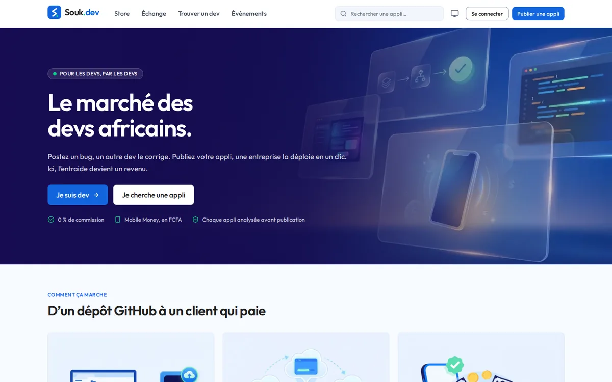
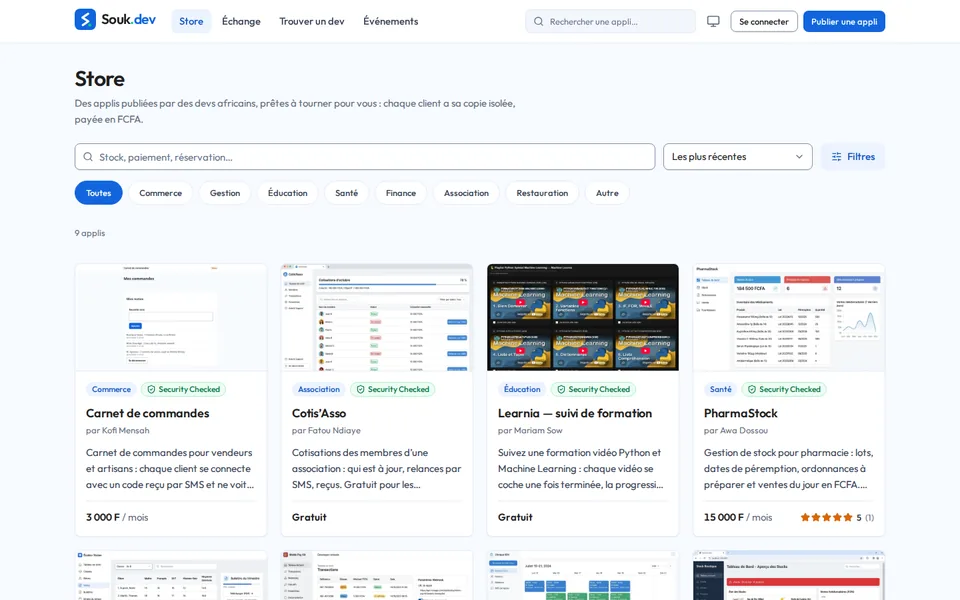
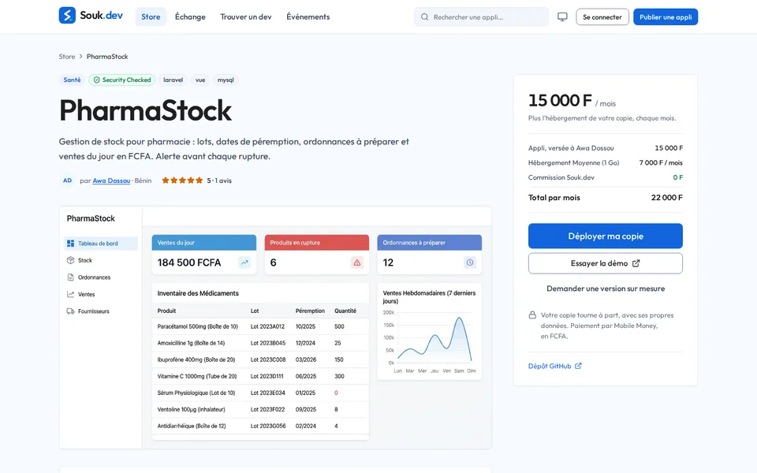
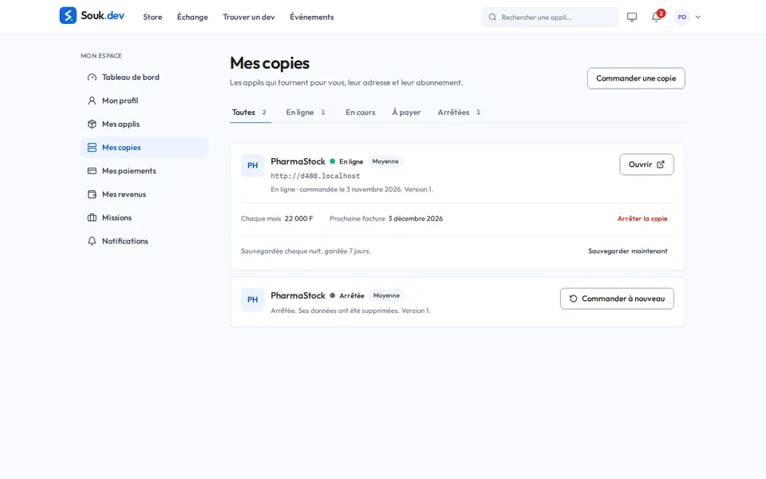
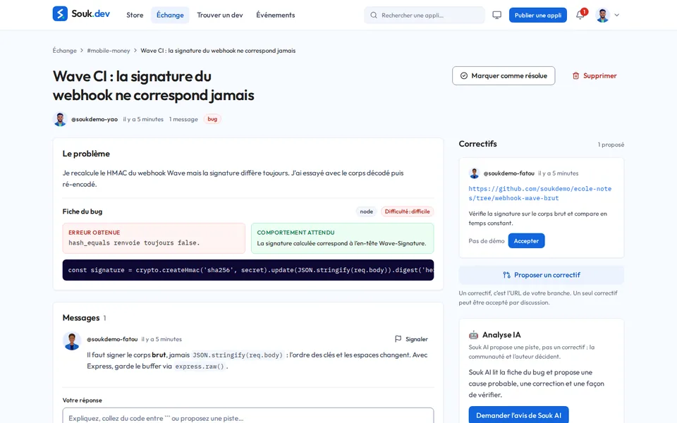
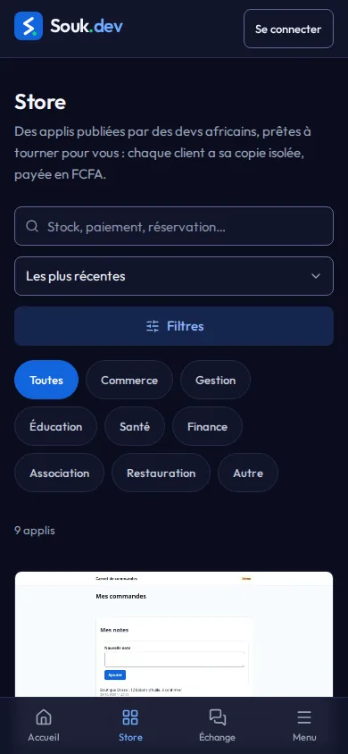

# Souk.dev

**La plateforme d'échange des devs africains, et leur marché.** Dans l'**Échange**, les devs
s'entraident : ils postent leurs bugs, se proposent des correctifs, les voient tourner avant de
les accepter, et gagnent leur réputation. Dans le **Store**, ils publient leurs applis : une
pharmacie, une association ou une boutique en déploie **sa propre copie** en un clic, paie par
Mobile Money en FCFA, et l'ouvre sur sa propre adresse quelques minutes plus tard.

**Les devs d'abord** : les clients sont un débouché pour eux, pas le cœur du produit.

**En ligne : [soukdev.shop](https://soukdev.shop)**



| Le Store | La fiche d'une appli |
|---|---|
|  |  |
| **Mes copies** | **Une discussion de l'Échange** |
|  |  |

<p align="center"></p>

## L'Échange : l'entraide entre devs

Tout y est **gratuit**, et rien n'oblige à déployer quoi que ce soit.

1. **Poster son problème** dans un canal (`#laravel`, `#mobile-money`, ou par pays comme
   `#laravel-benin`) ou sur la page de son appli, avec une étiquette : `bug`, `question`,
   `tuto`, `projet` ou `entraide`. Un bug est **structuré** : erreur obtenue, comportement
   attendu, techno, extrait de code, difficulté. On y joint son dépôt GitHub, son appli du
   Store ou une démo déjà en ligne, affichée dans un cadre isolé.
2. **Les autres devs répondent**, en direct, et **proposent un correctif** : l'adresse de leur
   branche ou de leur fork, avec une démo s'ils le veulent.
3. **Voir le correctif tourner avant de l'accepter** : une **copie de test gratuite** de deux
   heures, ou la version corrigée lancée par celui qui l'a proposée.
4. **L'auteur accepte** le correctif (il le fusionne lui-même sur GitHub, Souk.dev n'a jamais
   accès en écriture à son code). La discussion est résolue, et celui qui a aidé gagne de la
   réputation.

**Souk AI** : sur un bug, l'auteur peut demander une analyse IA, affichée **à côté** des
réponses de la communauté, jamais à leur place. Rien ne part chez le fournisseur sans son
accord ([docs/souk-ai.md](docs/souk-ai.md)).

**La réputation ne récompense que ce que quelqu'un d'autre a validé** : un correctif accepté
(+50 XP), une appli publiée (+100), une mission terminée (+100, plus 10 × la note du client),
un événement organisé (+50). Il n'y a pas de votes. Viennent ensuite les niveaux (Débutant,
Contributeur, Confirmé, Expert), les badges (Premier correctif, Chasseur de bugs, Fiable…) et le
**Souk Score** sur 1000, qui mesure la qualité et l'activité récente : un nouveau qui aide bien
peut dépasser un ancien devenu inactif.

**Autour** : des **événements** en ligne ou en présentiel (inscription, avis après coup), et un
**espace entreprises** pour trouver un dev disponible par compétence, spécialité ou pays, trié
par Souk Score. On peut le recruter, ou demander à l'auteur d'une appli une version sur mesure :
c'est une **mission** privée, sans enchères, notée par le client à la fin.

Corriger un bug dans l'Échange n'est pas rémunéré : c'est de l'entraide, payée en réputation. Un
dev gagne de l'argent avec le prix de ses applis et ses missions.

## Le Store : publier, déployer, être payé

1. **Le dev publie** son appli depuis un dépôt GitHub public. Souk.dev vérifie le dépôt (secrets
   avec gitleaks, failles avec Trivy), mesure la mémoire de l'appli et recommande une formule
   d'hébergement.
2. **Le client commande sa copie** sur le Store et paie (Mobile Money ou carte, via SasPay).
3. **Souk.dev la fait tourner** : une copie neuve et isolée par client, sur son sous-domaine,
   avec ses sauvegardes, ses mises à jour (et le retour arrière si besoin) et l'export de ses
   données.
4. **Chaque mois**, le client paie l'hébergement et le prix de l'appli. Le prix de l'appli va
   **entièrement au dev** : Souk.dev ne prend aucune commission et gagne seulement sur
   l'hébergement. Le client reçoit un rappel avant l'échéance ; sans paiement, sa copie est
   suspendue, ses données gardées, et elle repart dès qu'il paie.

Le client peut aussi noter l'appli, et le dev suit ses vues, ses copies et ses revenus, reversés
sur son Mobile Money.

| Formule | Mémoire | Processeur | Hébergement, par mois |
|---|---|---|---|
| Petite | 512 Mo | 0,5 cœur | 3 500 F |
| Moyenne | 1 Go | 1 cœur | 7 000 F |
| Grande | 2 Go | 2 cœurs | 13 500 F |

Le dev fixe le prix de son appli : gratuite, mensuelle ou payée une seule fois. Le calcul des
formules est dans [DECISIONS.md](DECISIONS.md#business-model).

## Quelles applis peut-on publier ?

**Pas seulement des sites statiques.** Souk.dev fait déjà tourner toute appli web complète, du
moment qu'elle apporte sa propre base dans Docker. Exemples du jeu de démo :

- Laravel + Vue + MySQL (gestion de pharmacie) ;
- Django + PostgreSQL (rendez-vous de clinique) ;
- Go + PostgreSQL + Redis (stock de boutique) ;
- une appli sans serveur à elle, grâce au [backend intégré](docs/backend-integre.md) de
  Souk.dev, qui lui fournit la base et la connexion par SMS (Carnet de commandes).

**Les conditions :**

- un dépôt GitHub **public**, avec à sa racine un `docker-compose.yml` et un `soukdev.json` ;
- **un seul** service ouvert sur le web, sur un seul port, et **6 services** au plus ;
- **2 Go** de mémoire au plus (formule Grande) ;
- **aucun accès au serveur** : ni le Docker de la machine, ni ses dossiers, ni ports publiés,
  ni mode privilégié ;
- **aucun secret dans le dépôt** : les mots de passe sont générés par la plateforme, les
  réglages du client lui sont demandés à la commande.

**Ne passent pas pour l'instant :** les applis liées au compte cloud de leur auteur (Supabase,
Firebase), celles qui lancent des conteneurs, celles qui dépassent 2 Go, et tout ce qui n'est
pas du web (appli mobile, jeu en UDP). Les deux premiers cas sont prévus après le hackathon :
[un Supabase par copie (#30)](https://github.com/octavebahoun/Souk.dev/issues/30) et
[un Docker isolé par copie (#31)](https://github.com/octavebahoun/Souk.dev/issues/31).

### Un `soukdev.json` en exemple

```json
{
  "version": 1,
  "service_web": { "nom": "web", "port": 80 },
  "backend": "propre",
  "variables": [
    { "nom": "BOUTIQUE_NOM", "source": "client", "libelle": "Nom de votre boutique", "requis": true },
    { "nom": "DB_PASSWORD", "source": "plateforme" },
    { "nom": "APP_ENV", "source": "fixe", "valeur": "production" }
  ]
}
```

- `service_web` : le seul conteneur joignable depuis le web, et son port.
- `backend` : `propre` (la base est un service de votre `docker-compose.yml`) ou `integre`
  (Souk.dev la fournit, avec vos migrations SQL dans le dossier `migrations`).
- `variables` : `client` (demandée au client à la commande), `plateforme` (un secret généré
  pour chaque copie) ou `fixe` (la même valeur partout). Elles arrivent dans le `.env` de la
  copie, que votre `docker-compose.yml` lit avec `${DB_PASSWORD}`.

Le schéma complet : [`backend/soukdev.schema.json`](backend/soukdev.schema.json).

## Pour l'équipe de Souk.dev

Vue financière tirée d'un grand livre inaltérable, reversements aux devs, avoirs. Modération
(signalements, suspensions, politique d'abus automatique), plusieurs serveurs, sauvegardes,
alertes.

## Installer en local en moins de 10 minutes

Il faut Docker (avec Compose v2) et Git, et les ports 80, 5173, 8000 et 8080 libres. Rien
d'autre : PHP, Node et PostgreSQL tournent dans les conteneurs.

```sh
git clone https://github.com/octavebahoun/Souk.dev.git
cd Souk.dev
docker compose up -d            # premier démarrage : 3 à 5 minutes (images, dépendances, migrations)

# Le jeu de démo : comptes, applis, discussions, factures (identifié comme tel)
docker compose exec -T -u 1000 api php artisan db:seed --class=DemoSeeder
# Les dépôts des applis de démo, servis en local : une commande construit une vraie copie
docker compose exec -T -u 1000 api php artisan demo:miroirs
```

Puis ouvrez **http://localhost:5173**. Sur la page de connexion, en développement, le bloc
« Comptes de démo » ouvre une session sans e-mail ni GitHub :

| Compte | Pour essayer |
|---|---|
| Awa Dossou (dev) | publier, l'Échange, ses revenus et son reversement |
| Pharmacie du Port (client) | commander PharmaStock, payer sur le simulateur, ouvrir sa copie |
| Équipe Souk.dev (admin) | finances, serveurs, modération |

Le paiement passe par le **simulateur SasPay** (aucun argent réel), et les copies s'ouvrent sur
`http://{copie}.localhost`. Les clés réelles (SasPay, DeepSeek, Resend, GitHub) se mettent dans
`backend/.env`, jamais commité ; sans elles, chaque service utilise son adaptateur simulé.

## Mettre en production

`./scripts/prod.sh up -d --build`, avec `backend/.env.prod` rempli : HTTPS, un domaine à part
pour les copies (jamais un sous-domaine de la plateforme), sauvegardes de nuit et test de
restauration. Sur un serveur qui héberge déjà d'autres sites derrière un proxy (Caddy…),
Souk.dev se place derrière lui (`MOTEUR_TLS_TRAEFIK=false`). Tout est dans
[docs/exploitation.md](docs/exploitation.md).

## Vérifier

```sh
docker compose exec -T api php artisan test          # PHPUnit : API, moteur, argent, contrat
cd frontend
npm ci && npx playwright install chromium            # une fois, sur la machine
npm test                                             # Vitest
npm run lint && npx tsc -b                           # ESLint, TypeScript
npm run e2e                                          # Playwright contre la plateforme lancée
npm run e2e:captures                                 # captures 3 tailles × 2 thèmes
```

## Documentation

| | |
|---|---|
| [Architecture](docs/architecture.md) | services, chemin d'une requête, moteur, argent, temps réel |
| [Paiement et grand livre](docs/paiement.md) | facturation, webhook, rapprochement, reversements, avoirs |
| [Exploitation](docs/exploitation.md) | production, proxy existant, sauvegarde et restauration, journaux, alertes, secrets |
| [Modération](docs/moderation.md) | signalements, sanctions, politique d'abus |
| [Plusieurs serveurs](docs/machines.md) · [multi-VPS](docs/multi-vps.md) | machines, sondes, placement |
| [Mises à jour](docs/mises-a-jour.md) · [Backend intégré](docs/backend-integre.md) · [Souk AI](docs/souk-ai.md) | |
| [Design](docs/design.md) | tokens, composants, règles d'écran |
| [`openapi.yaml`](openapi.yaml) · [`REVERB.md`](REVERB.md) | le contrat de l'API, les événements temps réel |
| [`RELEASE_NOTES.md`](RELEASE_NOTES.md) | ce qui est livré, vérifié, et les limites connues |
| [`DECISIONS.md`](DECISIONS.md) · [`PROGRESS.md`](PROGRESS.md) | les choix et leur raison, l'avancement et les vérifications |
| [`LICENSES.md`](LICENSES.md) · [`AI_USAGE.md`](AI_USAGE.md) | licences des dépendances, usage de l'IA |

## Pile

Laravel 13 (PHP 8.4), PostgreSQL 16, Laravel Reverb, React 19, Vite, TypeScript, Tailwind CSS 4,
Traefik, Docker. Dépendances sous licences permissives uniquement (MIT, Apache 2.0, BSD, ISC,
PostgreSQL) : voir [LICENSES.md](LICENSES.md).

Né pour le concours CADEV 2026 : le brief d'origine est dans
[docs/brief-concours.md](docs/brief-concours.md).
